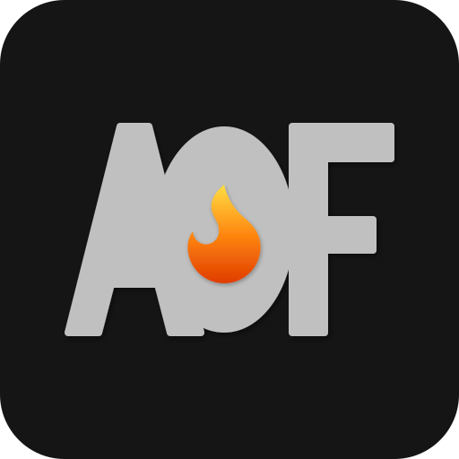
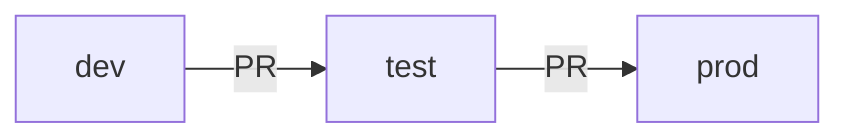

<p align="center">
  
</p>

<h3 align="center">AllOnFire 🔥</h3>

<br />

<p align="center">
  
  
  
  
  
</p>

---

## 🔥 About

A pnpm and Turborepo monorepo for private web apps and the API behind them. What apps share, such as sign-in, database, image storage and UI, lives in packages.

---

## 📱 Apps

<p align="center">
  
</p>

<h3 align="center">Back Office</h3>

<p align="center">
  
  
  
  
  
</p>

<p align="center">
  Where the Admins change who can do what across the Apps: Users, Images and the mail Services, wearing the Japan Design.
</p>

<p align="center">
  📖 <a href="docs/guides/back-office.md">See the guide</a>
</p>

<p align="center">
  
</p>

<h3 align="center">Photos & Games</h3>

<p align="center">
  
  
  
  
  
</p>

<p align="center">
  Our private place for two: a photo gallery and the Memory game, in Italian and English, installable as a PWA and wearing the Ocean Design.
</p>

<p align="center">
  📖 <a href="apps/laura/">See the full docs</a>
</p>

---

## 📦 Packages

| | Package | Description |
|-|---------|-------------|
| 🗄️ | **[@allonfire/database](packages/database/)** | Prisma client, PostgreSQL services and the Liquibase changelog |
| 🔐 | **[@allonfire/auth](packages/auth/)** | Better Auth config, Roles and access, the API's guards and the Apps' Session helpers |
| 📁 | **[@allonfire/storage](packages/storage/)** | S3/MinIO file uploads, image processing (Sharp, AVIF with a blur placeholder) |
| 🎨 | **[@allonfire/ui](packages/ui/)** | The AOF components the Apps share (shadcn/ui on Base UI, Tailwind) |
| 🖌️ | **[@allonfire/design](packages/design/)** | The Designs (fonts, theme CSS, rules) and the Brand |
| 🧩 | **[@allonfire/shadcn](packages/shadcn/)** | The components the shadcn CLI generates, written by it alone |
| 🔧 | **[@allonfire/core](packages/core/)** | Shared constants, helpers and the Next scaffolding |
| ⚙️ | **[@allonfire/config](packages/config/)** | Shared TypeScript configuration |

## 🗂️ Project Structure

<p>
  
  
  
  
</p>

```
allonfire/
  apps/
    api/                  Hono HTTP backend (auth, Images, Laura's routes)
    back-office/          Next.js admin app
    laura/                Next.js Gallery and Memory game
  packages/
    auth/                 Better Auth config, Roles, guards
    config/               TypeScript and test config, repository checks
    core/                 Shared constants, helpers, Next scaffolding
    database/             Prisma client, services, Liquibase changelog
    design/               Designs and the Brand
    shadcn/               Generated shadcn/ui components
    storage/              S3/MinIO uploads + image processing
    ui/                   Shared AOF components
  docker/                 Docker Compose + Dockerfile
  docs/                   Project documentation
  .github/                CI/CD workflows
```

## 🏗️ Infrastructure

| | Component | Stack |
|-|-----------|-------|
| 🖥️ | **VPS** | Hetzner |
| 🚀 | **Orchestrator** | Dokploy |
| 🐘 | **Database** | PostgreSQL 16 |
| 🔒 | **Proxy** | Traefik + Let's Encrypt SSL |
| 🔄 | **CI** | GitHub Actions |

### 🚢 Deploy



Only a push to `prod` deploys. Setup, rollback and how it picks what to build:
[Deployment](docs/guides/deployment.md).

## 💻 Run it locally

You need Node 24, pnpm 9 and Docker. The scripts are bash (on Windows use WSL).

1. `pnpm install`
2. Create the env files, each from the `.env.example` beside it, and fill in the Local values:

   | File | For |
   |------|-----|
   | `apps/api/.env` | the API |
   | `apps/back-office/.env.development` | the Back Office |
   | `apps/laura/.env.development` | Laura |
   | `packages/database/.env` | the database, and your Admin (`DATABASE_SEED_ADMIN_*`) |
   | `packages/storage/.env` | image storage |

3. `pnpm dev:setup`, once: starts the services and fills the database.
4. `pnpm dev`

| | Open | Address |
|-|------|---------|
| 🛠️ | Back Office | http://localhost:3400 |
| 🐙 | Laura | http://localhost:3200 |
| 🔌 | API | http://localhost:3300 |
| 🗄️ | Database console | http://localhost:8080 |
| 📁 | Storage console | http://localhost:9001 |

📱 To open the Apps on your phone: [Local and the tailnet](docs/guides/local.md).

## 📚 Docs

| You want to | Read |
|-------------|------|
| learn the words the project uses | [CONTEXT.md](CONTEXT.md) |
| work on the API | [API guide](docs/guides/api.md) |
| work on a Next App | [Next Apps](docs/guides/next-apps.md) |
| change the database | [Database](docs/guides/database.md) |
| write or run tests | [Testing](docs/guides/testing.md) |
| ship or roll back | [Deployment](docs/guides/deployment.md) |
| know why something is built this way | [Decision records](docs/adr/) |

---

<p align="center">
  Made with ❤️ and way too much ☕
</p>

