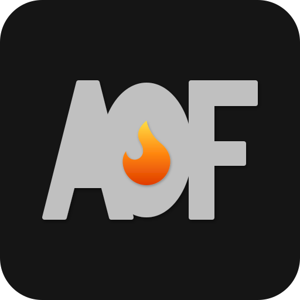

<p align="center">
  
</p>

<h3 align="center">AllOnFire 🔥</h3>

<br />

<p align="center">
  
  
  
  
  
</p>

---

## 🔥 About

AllOnFire is a Turborepo-powered monorepo with shared packages, apps, and infrastructure managed through pnpm workspaces. It provides a unified development experience with shared TypeScript config, UI components, database services, and CI/CD pipelines across all projects.

## 📱 Apps

<!-- Add a screenshot for each app as it's built -->

<p align="center">
  
</p>

<h3 align="center">Photos & Games</h3>

<p align="center">
  
  
  
  
  
  
  
</p>

<p align="center">
  Private photo gallery and games app with i18n support, S3/MinIO storage, and blurhash placeholders.
</p>

<p align="center">
  📖 <a href="apps/laura/">See the full docs</a>
</p>

---

## 📦 Packages

Shared libraries consumed by all apps in the monorepo.

| | Package | Description |
|-|---------|-------------|
| 🗄️ | **[@allonfire/database](packages/database/)** | Prisma ORM, PostgreSQL services, encrypted token storage |
| 🔐 | **[@allonfire/auth](packages/auth/)** | Shared BetterAuth config, session guards, login UI |
| 📁 | **[@allonfire/storage](packages/storage/)** | S3/MinIO file uploads, image processing (Sharp + blurhash) |
| 🎨 | **[@allonfire/ui](packages/ui/)** | Shared UI components (shadcn/ui + Radix + Tailwind) |
| 🔧 | **[@allonfire/core](packages/core/)** | Shared constants, helpers and the Next scaffolding |
| ⚙️ | **[@allonfire/config](packages/config/)** | Shared TypeScript configuration |

## 🗂️ Project Structure

<p>
  
  
  
  
</p>

Apps, shared packages, infrastructure, and CI/CD — all managed through pnpm workspaces and Turborepo.

```
allonfire/
  apps/
    laura/                Next.js photos & games app
  packages/
    auth/                 Shared BetterAuth config
    database/             Prisma ORM + services
    storage/              S3/MinIO uploads + image processing
    ui/                   Shared UI components
    core/                 Shared constants, helpers, Next scaffolding
    config/               TypeScript config
  docker/                 Docker Compose + Dockerfile
  docs/                   Project documentation
  .github/                CI/CD workflows
```

## 🏗️ Infrastructure

Production deployment stack powering all apps and services.

| | Component | Stack |
|-|-----------|-------|
| 🖥️ | **VPS** | Hetzner |
| 🚀 | **Orchestrator** | Dokploy |
| 🐘 | **Database** | PostgreSQL 16 |
| 🔒 | **Proxy** | Traefik + Let's Encrypt SSL |
| 🔄 | **CI** | GitHub Actions |

### 🚢 Deploy

A push to `prod` runs `.github/workflows/deploy.yml`: it builds an image only
for each Deploy unit (`api`, `back-office`, `db-migrate`) affected since the
last deploy (the `deployed/prod` tag), pushes it to GHCR as `:<sha>`, tags
every one `:prod` once all are built, and asks Dokploy to redeploy the one
compose project, which recreates only the services whose image changed (ADR 0018).

One-time setup:

1. GitHub, environment `prod`: secrets `DOKPLOY_API_KEY`, `PROD_STORAGE_ENDPOINT`, `PROD_NEXT_PUBLIC_API_URL`; variables `DOKPLOY_URL`, `DOKPLOY_COMPOSE_ID`.
2. Dokploy: a registry entry for `ghcr.io` with a GitHub token that has only `read:packages`.
3. Dokploy compose project `allonfire` (`docker/docker-compose.prod.yml`): auto-deploy off; env holds `DATABASE_URL`, `API_REDIS_URL`, `AUTH_SECRET`, `AUTH_COOKIE_DOMAIN`, `API_HOST`, `BACK_OFFICE_HOST`, `MINIO_ACCESS_KEY`, `MINIO_SECRET_KEY`.
4. First deploy: with no `deployed/prod` tag yet, the workflow builds every unit; a manual run (`workflow_dispatch`) does the same later.

Before the API starts, the one-shot `storage-setup` service creates the `image` bucket with its read-only policy, only when missing; nothing is uploaded by hand.

Rollback: `docker buildx imagetools create -t ghcr.io/isaiascope/allonfire-<unit>:prod ghcr.io/isaiascope/allonfire-<unit>:<sha>`, then redeploy the compose project in Dokploy.

Laura is out of Production until its rebuild.

### 💻 Local

`pnpm dev:setup` starts the Local stack, applies the changelog, seeds the
real Admin (`DATABASE_SEED_ADMIN_*` in `packages/database/.env`, Admin in
every App) and creates the `image` bucket with its policy: Local holds what
Production holds. The Fixtures live only in Test databases; remove
`DATABASE_SEED_MODE` and `DATABASE_SEED_LAURA_VIEWER_*` from an older `.env`.
`packages/storage/.env` (from its `.env.example`) holds the Local MinIO
login the setup and the e2e run's bucket use.

`pnpm dev:tailscale` serves each dev App over Tailscale as its own Tailscale
Service, with HTTPS: the Back Office at `https://back-office.<tailnet>.ts.net`,
Laura at `https://laura.<tailnet>.ts.net`. Tailscale must be running on the
Mac and on each device that opens them, with MagicDNS and HTTPS Certificates
on in the tailnet's DNS settings. Tailscale keeps serving them across
restarts; `pnpm dev:tailscale:off` stops it. `next dev` accepts only names
on this tailnet, which it reads from `tailscale status` at start: sign in to
Tailscale before `pnpm dev`, or restart `pnpm dev` after.

One-time setup, in the admin console:

1. Access controls: add the tag, let it host the Services, and let members
   reach them:

   ```json
   "tagOwners": { "tag:dev": ["autogroup:admin"] },
   "autoApprovers": {
     "services": {
       "svc:back-office": ["tag:dev"],
       "svc:laura": ["tag:dev"]
     }
   },
   "grants": [
     { "src": ["autogroup:member"], "dst": ["svc:back-office", "svc:laura"], "ip": ["443"] }
   ]
   ```

   Merge into the existing `tagOwners` and `grants`, and keep the default
   allow-all grant.
2. Tag the Mac (`tailscale up --advertise-tags=tag:dev` with your other
   `up` flags, or Machines, Edit ACL tags). A Service host must be tagged,
   so the Mac then belongs to the tag, not to a user.
3. Services: define `back-office` and `laura`, each on `tcp:443`.
4. Run `pnpm dev:tailscale`. A Service the Mac advertised before it was
   defined stays pending: `tailscale serve clear svc:<name>`, then run it
   again, and the auto-approval applies.

Why Services, and what a new App needs: ADR 0021.

---

<p align="center">
  Made with ❤️ and way too much ☕
</p>

