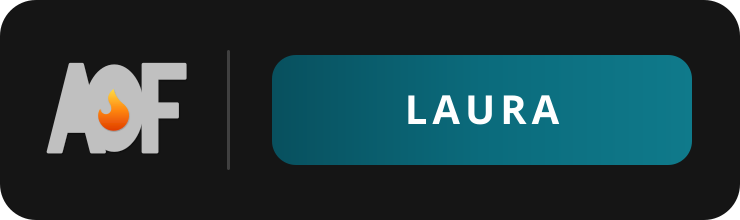

<p align="center">
  
</p>

<h1 align="center">Photos & Games</h1>

<p align="center">
  
  
  
  
  
</p>

<p align="center">
  Our private place for two: a photo gallery and the Memory game, in Italian and English, installable as a PWA and wearing the Ocean Design.
</p>

---

## 📱 Routes

| | Route | Page | Role |
|-|-------|------|------|
| 🖼️ | `/` | Gallery | User |
| ⭐ | `/favorites` | Favorites | User |
| 🃏 | `/memory` | Memory game | User |
| 🏆 | `/memory/leaderboard` | Memory leaderboard | User |
| 📤 | `/upload` | Upload | Admin |

Sign in, Forgot password, Reset password, Email verified and Offline work signed
out. Nobody registers: an Admin adds Users in the Back Office.

## 🔧 Run it

First time: the root [Run it locally](../../README.md#-run-it-locally). Then:

| I want to | Command |
|-----------|---------|
| work on it, with the API and the services (`:3200`) | `pnpm dev` (from the root) |
| run only this app | `pnpm --filter @allonfire/laura dev` |
| unit tests | `pnpm --filter @allonfire/laura test` |
| browser tests | `pnpm --filter @allonfire/laura test:browser` |
| end-to-end on a production build (`:3210`) | `pnpm --filter @allonfire/laura test:e2e` |
| look at a production build (`:3220`) | `pnpm --filter @allonfire/laura preview` |

## 🗂️ Where things are

```
src/
  app/             pages and Next's special files
  environment/     the env variables, checked at start
  features/        what each part of the app does
  shared/          constants, components, test helpers
```

The frame, account menu, sign-in pages, notices and install support are not
here: they come from the shared packages.

## 🔑 Environment

Start from `.env.example`.

| Variable | Required | Description |
|----------|:--------:|-------------|
| `API_URL` | yes | The API's address for the server |
| `API_AUTH_URL` | yes | The API's Auth address for the server |
| `NEXT_PUBLIC_API_URL` | yes | The API's address for the browser, baked in at build |
| `AUTH_APP` | yes | `LAURA`: the App a sign-in is for |
| `AUTH_COOKIE_DOMAIN` | | The parent domain the apps share the Session cookie on |
| `LAURA_URL` | yes | This app's own address; build and runtime must match |
| `TELEMETRY_*` | | No endpoint, no telemetry |

## ⚠️ Watch out

- It reads the API only: no database client and no Better Auth here.
- `NEXT_PUBLIC_API_URL` and `LAURA_URL` are set at build time: change one, build again.

## 📚 More

| You want to | Read |
|-------------|------|
| know its pages, API routes, tables, caches and Roles | [Laura guide](../../docs/guides/laura.md) |
| work on any Next App | [Next Apps](../../docs/guides/next-apps.md) |
| open it on your phone | [Local and the tailnet](../../docs/guides/local.md) |

## 🐙 Credits

Laura's mascot art is open emoji art and icons (`packages/design/src/designs/ocean/SOURCES.md` lists every picture and its licence):

- Noto Emoji and Noto classic emoji (Google), Apache 2.0.
- Firefox emoji (Mozilla), Apache 2.0.
- Fluent Emoji Flat (Microsoft), MIT.
- Material Design Icons, Apache 2.0.
- The one-colour [octopus](https://game-icons.net/1x1/lorc/octopus.html) and [crab](https://game-icons.net/1x1/lorc/crab.html) are by Lorc, from [game-icons.net](https://game-icons.net), licensed [CC BY 3.0](https://creativecommons.org/licenses/by/3.0/). Recoloured to the theme; the drawing is unchanged.

---

<p align="center">
  ⬅️ <a href="../../README.md">Back to monorepo root</a>
</p>
